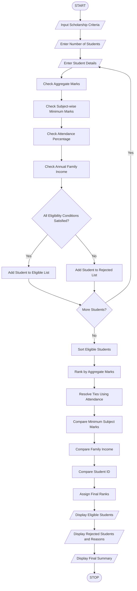

## 1. Problem Statement

Develop a Python-based University Scholarship Allocation System to evaluate students for scholarship eligibility based on aggregate marks, subject-wise minimum marks, attendance percentage, and annual family income.

The system should accept student details, verify all eligibility conditions, and classify students as eligible or ineligible. Eligible students must be ranked in descending order based on aggregate marks.

If two or more students have equal aggregate marks, ties should be resolved using the following predefined rules:

1. Higher attendance percentage.
2. Higher minimum subject marks.
3. Lower annual family income.
4. Lower student ID.

Finally, the system should display the ranked list of eligible students, rejected students with reasons, and the total number of eligible and ineligible applicants.

## 2. Algorithm

1. Start the program.
2. Read the scholarship eligibility criteria.
3. Enter the number of student applicants.
4. Read each student's ID, name, aggregate marks, subject-wise marks, attendance, and family income.
5. Check the following eligibility conditions:
   - Aggregate marks must be at least 75%.
   - Every subject mark must be at least 60.
   - Attendance must be at least 75%.
   - Annual family income must not exceed ₹3,00,000.
6. If all conditions are satisfied, add the student to the eligible list.
7. Otherwise, add the student to the rejected list with the reason.
8. Sort eligible students using:
   - Aggregate marks in descending order.
   - Attendance in descending order.
   - Minimum subject marks in descending order.
   - Family income in ascending order.
   - Student ID in ascending order.
9. Assign ranks to eligible students.
10. Display eligible students and rejected students.
11. Display the final summary.
12. Stop.

 3. Flowchart


## 5. Sample Input

text

```
Enter number of students: 5

Enter details of Student 1
Student ID: 101
Student Name: Arun
Aggregate Marks: 85
Enter subject marks separated by spaces: 70 80 90
Attendance Percentage: 90
Annual Family Income: 200000

Enter details of Student 2
Student ID: 102
Student Name: Balu
Aggregate Marks: 85
Enter subject marks separated by spaces: 75 85 90
Attendance Percentage: 85
Annual Family Income: 180000

Enter details of Student 3
Student ID: 103
Student Name: Charan
Aggregate Marks: 72
Enter subject marks separated by spaces: 65 70 75
Attendance Percentage: 90
Annual Family Income: 150000

Enter details of Student 4
Student ID: 104
Student Name: Divya
Aggregate Marks: 90
Enter subject marks separated by spaces: 80 85 95
Attendance Percentage: 95
Annual Family Income: 250000

Enter details of Student 5
Student ID: 105
Student Name: Esha
Aggregate Marks: 80
Enter subject marks separated by spaces: 65 70 75
Attendance Percentage: 70
Annual Family Income: 200000
```

## 6. Sample Output

text

```
========== ELIGIBLE STUDENTS ==========

Rank ID   Name     Marks   Attendance
1    104  Divya     90.0      95.0%
2    101  Arun      85.0      90.0%
3    102  Balu      85.0      85.0%

========== REJECTED STUDENTS ==========

ID: 103
Name: Charan
Reason: Aggregate marks below 75%

ID: 105
Name: Esha
Reason: Attendance below 75%

========== FINAL SUMMARY ==========

Total Applicants: 5
Eligible Students: 3
Rejected Students: 2

Scholarship Allocation Completed!
```

