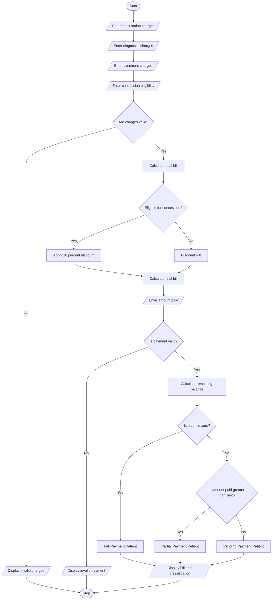

## 1. Problem Statement

The Hospital Billing and Patient Classification System is designed to calculate the total hospital bill for a patient based on consultation charges, diagnostic test charges, and treatment charges. The system applies conditional concessions according to the patient's eligibility, validates billing constraints, and classifies patients based on a specified payment policy.

The program calculates the final bill after applying eligible discounts and classifies the patient as a **Full Payment Patient, Partial Payment Patient, or Pending Payment Patient** based on the payment status.


## 2. Algorithm

**Step 1:** Start the program.

**Step 2:** Read the consultation, diagnostic, and treatment charges.

**Step 3:** Read the patient's concession eligibility and payment amount.

**Step 4:** Validate the input values.
- Charges must not be negative.
- Payment must not be negative.
- Payment must not exceed the final bill.

**Step 5:** Calculate the total bill.

Total Bill = Consultation Charges + Diagnostic Charges + Treatment Charges

**Step 6:** Check concession eligibility.
- If the patient is eligible, apply a 10% concession.
- Otherwise, apply no concession.

**Step 7:** Calculate the final bill.

Final Bill = Total Bill − Concession

**Step 8:** Calculate the remaining balance.

Balance = Final Bill − Amount Paid

**Step 9:** Classify the patient.
- If the balance is zero, classify as **Full Payment**.
- If the amount paid is greater than zero but the balance remains, classify as **Partial Payment**.
- If no amount is paid, classify as **Pending Payment**.

**Step 10:** Display the bill details and patient classification.

**Step 11:** Stop the program.

## 3. Flowchart Using 


**How to view the flowchart:** Copy the Mermaid code and paste it into the Mermaid Live Editor: [Mermaid Live Editor](https://mermaid.live/?utm_source=chatgpt.com)

---

 

### 5. Sample Input

```text
Enter consultation charges: 500
Enter diagnostic charges: 1200
Enter treatment charges: 3000
Is the patient eligible for concession? (yes/no): yes
Enter amount paid: 2000
```

### 6. Sample Output

```text
--- HOSPITAL BILL DETAILS ---
Consultation Charges: Rs. 500.00
Diagnostic Charges: Rs. 1200.00
Treatment Charges: Rs. 3000.00
Total Bill: Rs. 4700.00
Concession: Rs. 470.00
Final Bill: Rs. 4230.00
Amount Paid: Rs. 2000.00
Remaining Balance: Rs. 2230.00
Patient Classification: Partial Payment Patient
```

---

