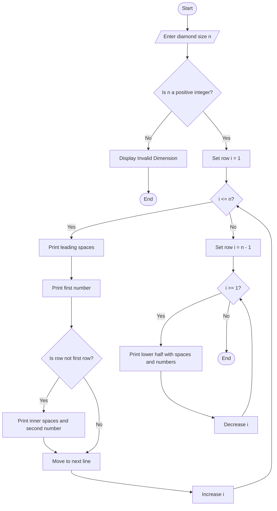

## 1. Problem Statement

Develop a Python program to generate a **hollow diamond numerical pattern** based on a user-specified dimension.

The program should:
1. Accept the diamond size from the user.
2. Validate the input dimension and reject invalid values.
3. Generate a symmetric hollow diamond using numbers.
4. Maintain proper spacing and alignment.
5. Display an error message if the dimension is less than 1.

## 2. Flowchart 


## 4. Sample Input

```text
Enter diamond size: 5
```

## 5. Sample Output

```text
Hollow Diamond Pattern:

    1
   2 2
  3   3
 4     4
5       5
 4     4
  3   3
   2 2
    1

```

