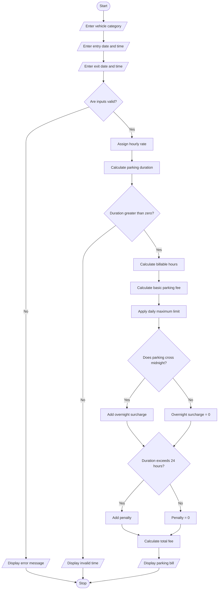

## 1. Problem Statement

The Smart Parking Fee Management System is designed to calculate parking charges based on vehicle category, entry time, exit time, overnight parking, daily limits, and penalty conditions.

The system accepts the vehicle type and parking entry and exit times. It validates the time inputs, calculates the total parking duration, and determines the parking fee according to the applicable rules.

If the vehicle stays overnight, the system applies the overnight parking charge. It also applies a daily maximum fee and additional penalties when applicable. Finally, it displays the parking duration, basic charges, penalties, and total amount payable.


## 2. Algorithm

**Step 1:** Start the program.

**Step 2:** Accept the vehicle category.

**Step 3:** Accept the entry time and exit time in `HH:MM` format.

**Step 4:** Validate the vehicle category and time inputs.

**Step 5:** Assign the hourly rate based on the vehicle category.

**Step 6:** Convert the entry and exit times into minutes.

**Step 7:** If the exit time is earlier than the entry time, consider the exit time to be on the following day.

**Step 8:** Calculate the total parking duration in minutes.

**Step 9:** Convert the parking duration into billable hours by rounding up any partial hour. Apply a minimum charge of one hour.

**Step 10:** Calculate the basic parking fee using the vehicle's hourly rate.

**Step 11:** Apply the daily maximum limit of ₹200 to the basic parking fee.

**Step 12:** Check whether the parking period crosses midnight. If it does, add the overnight surcharge of ₹50.

**Step 13:** Check whether the parking duration exceeds 24 hours. If it does, add a penalty of ₹100.

**Step 14:** Calculate the final parking fee.

**Step 15:** Display the vehicle category, parking duration, billable hours, basic fee, overnight surcharge, penalty, and total amount.

**Step 16:** Stop the program.

## 3. Flowchart Using 



                

## 5. Sample Input

```text
SMART PARKING FEE MANAGEMENT SYSTEM
1. Two-wheeler - Rs. 10/hour
2. Car - Rs. 20/hour
3. Heavy vehicle - Rs. 30/hour
Enter vehicle category (two-wheeler/car/heavy): car
Enter entry date and time (YYYY-MM-DD HH:MM): 2026-10-29 22:00
Enter exit date and time (YYYY-MM-DD HH:MM): 2026-10-30 02:00
```

## 6. Sample Output

```text
----- PARKING BILL -----
Vehicle Category: car
Entry Time: 2026-10-29 22:00:00
Exit Time: 2026-10-30 02:00:00
Parking Duration: 4:00:00
Billable Hours: 4
Hourly Rate: Rs. 20
Basic Parking Fee: Rs. 80
Parking Fee After Daily Limit: Rs. 80
Overnight Surcharge: Rs. 50
Penalty: Rs. 0
Total Parking Fee: Rs. 130
```

---

