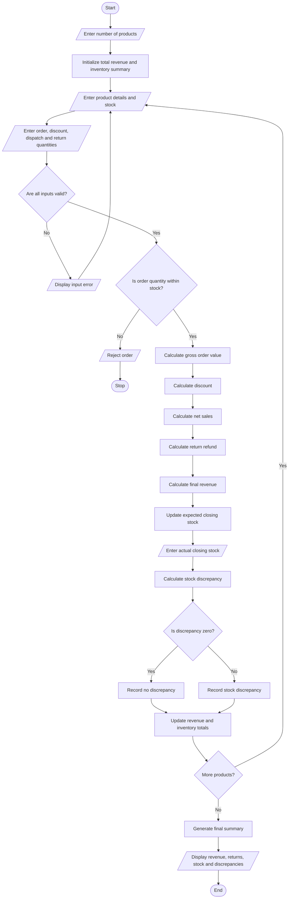

# Integrated E-Commerce Order Processing and Reconciliation Using Python

## 1. Problem Statement

The Integrated E-Commerce Order Processing and Reconciliation System is designed to manage the complete order processing cycle in an online shopping system. It processes product orders, calculates discounts, manages dispatches and returns, updates stock quantities, calculates revenue, identifies discrepancies, and generates a final inventory summary.

The system accepts product details, prices, available stock, order quantities, discount percentages, dispatched quantities, and returned quantities. It validates the inputs to prevent invalid orders and stock errors.

After processing orders, the system calculates the total sales amount, applies discounts, accounts for returned products, updates inventory, and compares expected and actual stock quantities to identify discrepancies. Finally, it displays the revenue summary and remaining inventory.


## 2. Algorithm

**Step 1:** Start the program.

**Step 2:** Enter the number of products to process.

**Step 3:** For each product, enter its name, unit price, opening stock, order quantity, discount percentage, dispatched quantity, and returned quantity.

**Step 4:** Validate the input values.
- Product price must not be negative.
- Stock and quantities must not be negative.
- Discount must be between 0% and 100%.
- Order quantity must not exceed available stock.
- Dispatched quantity must not exceed the ordered quantity.
- Returned quantity must not exceed the dispatched quantity.

**Step 5:** Calculate the gross order value.

Gross Order Value = Unit Price × Dispatched Quantity

**Step 6:** Calculate the discount.

Discount = Gross Order Value × Discount Percentage / 100

**Step 7:** Calculate net sales.

Net Sales = Gross Order Value − Discount

**Step 8:** Calculate the refund for returned products.

Refund = Discounted Unit Price × Returned Quantity

**Step 9:** Calculate the final revenue.

Final Revenue = Net Sales − Refund

**Step 10:** Update the stock quantity.

Expected Closing Stock = Opening Stock − Dispatched Quantity + Returned Quantity

**Step 11:** Enter the actual closing stock and compare it with the expected closing stock.

Discrepancy = Actual Closing Stock − Expected Closing Stock

**Step 12:** If the discrepancy is zero, display "No Discrepancy." Otherwise, display the difference.

**Step 13:** Calculate the total revenue from all products.

**Step 14:** Display the final inventory summary, revenue, returns, and discrepancies.

**Step 15:** Stop the program.

---

## 3. Flowchart Using 



## 5. Sample Input

```text
Enter number of products: 2

--- Product 1 ---
Enter product name: Laptop
Enter unit price: 50000
Enter opening stock: 20
Enter order quantity: 3
Enter discount percentage: 10
Enter dispatched quantity: 3
Enter returned quantity: 1
Enter actual closing stock: 18

--- Product 2 ---
Enter product name: Phone
Enter unit price: 20000
Enter opening stock: 50
Enter order quantity: 5
Enter discount percentage: 5
Enter dispatched quantity: 4
Enter returned quantity: 1
Enter actual closing stock: 48
```

## 6. Sample Output

```text
Product: Laptop
Gross Order Value: Rs. 150000.00
Discount: Rs. 15000.00
Net Sales: Rs. 135000.00
Refund: Rs. 45000.00
Final Revenue: Rs. 90000.00
Expected Closing Stock: 18
Actual Closing Stock: 18
Stock Status: No Discrepancy

Product: Phone
Gross Order Value: Rs. 80000.00
Discount: Rs. 4000.00
Net Sales: Rs. 76000.00
Refund: Rs. 19000.00
Final Revenue: Rs. 57000.00
Expected Closing Stock: 47
Actual Closing Stock: 48
Stock Discrepancy: 1

===== FINAL INVENTORY SUMMARY =====
Product          Opening  Dispatch   Return  Expected   Actual  Difference
Laptop                20         3        1        18       18           0
Phone                 50         4        1        47       48           1

===== RECONCILIATION REPORT =====
Total Products: 2
Total Dispatched: 7
Total Returned: 2
Total Refunds: Rs. 64000.00
Total Revenue: Rs. 147000.00
Products with Discrepancies: 1
```

---


