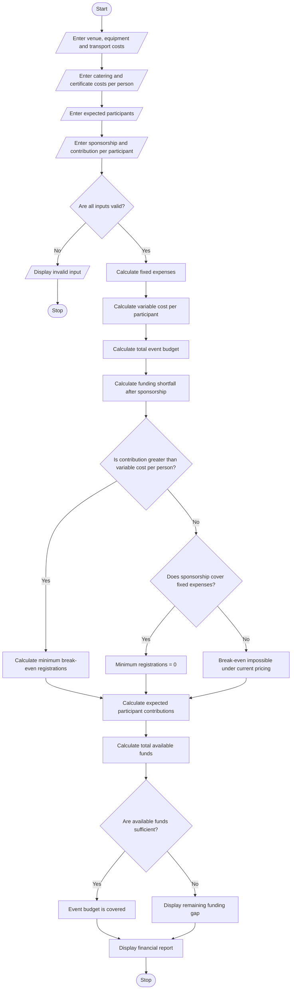

## 1. Problem Statement

The Campus Event Financial Planning System is designed to calculate the total expenses and financial requirements for organizing a college event. It considers venue rental, equipment, catering, transportation, and certificate costs.

The system accepts the estimated expenses, expected sponsorship amount, participant contribution per person, and expected number of participants. It calculates the total event budget, determines the sponsorship shortfall, estimates the contribution required from each participant, and identifies the minimum number of registrations needed to break even.

The program also checks whether the expected registrations and available sponsorship are sufficient to cover the event expenses. Finally, it displays a complete financial summary to help organizers plan the event effectively.


## 2. Algorithm

**Step 1:** Start the program.

**Step 2:** Enter the venue, equipment, transportation, catering-per-person, and certificate-per-person costs.

**Step 3:** Enter the expected number of participants.

**Step 4:** Enter the sponsorship amount and contribution per participant.

**Step 5:** Validate all inputs to ensure that costs, sponsorship, contributions, and participant counts are not negative.

**Step 6:** Calculate the total fixed expenses.

Fixed Expenses = Venue + Equipment + Transport

**Step 7:** Calculate the variable expenses.

Variable Expenses = (Catering Cost per Person + Certificate Cost per Person) × Number of Participants

**Step 8:** Calculate the total event budget.

Total Budget = Fixed Expenses + Variable Expenses

**Step 9:** Calculate the amount remaining after sponsorship.

Funding Shortfall = Maximum of (Total Budget − Sponsorship, 0)

**Step 10:** Calculate the minimum number of registrations required to break even.

Minimum Registrations = Minimum whole number of participants whose contributions, together with sponsorship, cover the total event costs.

**Step 11:** Compare expected registrations with the break-even registration count.

**Step 12:** Display the total budget, sponsorship, shortfall, participant contributions, and minimum registrations required.

**Step 13:** Stop the program.

---

## 3. Flowchart Using





## 5. Sample Input

```text
CAMPUS EVENT FINANCIAL PLANNING
Enter venue cost: Rs. 10000
Enter equipment cost: Rs. 5000
Enter transport cost: Rs. 3000
Enter catering cost per person: Rs. 200
Enter certificate cost per person: Rs. 50
Enter expected participants: 100
Enter sponsorship amount: Rs. 12000
Enter contribution per participant: Rs. 300
```

## 6. Sample Output

```text
===== CAMPUS EVENT FINANCIAL REPORT =====

Venue Cost: Rs. 10000.00
Equipment Cost: Rs. 5000.00
Transport Cost: Rs. 3000.00

Fixed Expenses: Rs. 18000.00
Variable Expenses: Rs. 25000.00
Total Event Budget: Rs. 43000.00

Sponsorship: Rs. 12000.00
Funding Shortfall Before Contributions: Rs. 31000.00

Expected Participants: 100
Contribution Per Participant: Rs. 300.00

Total Participant Contributions: Rs. 30000.00
Total Available Funds: Rs. 42000.00
Remaining Funding Gap: Rs. 1000.00

Minimum Registrations to Break Even: 120
Status: Additional funding is required.
```

---

