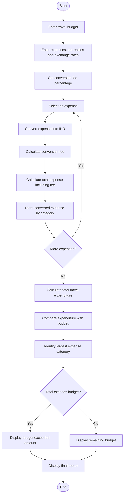

## 1. Problem Statement

Develop a Python program to analyze a travel budget using multiple currencies. The program converts travel expenses into Indian Rupees (INR) using the given exchange rates and includes conversion fees.

The program should:
1. Accept travel expenses from different categories and currencies.
2. Convert each expense into INR using the supplied exchange rate.
3. Calculate the currency conversion fee.
4. Calculate the total travel expenditure, including fees.
5. Compare the total expenditure with the planned budget.
6. Identify the largest expense category.
7. Display whether the travel expenses are within the budget or exceed it.

## 2. Flowchart 





## 4. Sample Input

The program uses the following sample values:

```text
Travel Budget = 50000

Exchange Rates:
1 USD = Rs. 85
1 EUR = Rs. 92
1 GBP = Rs. 110

Conversion Fee = 2%

Travel Expenses:
Hotel: 200 USD
Food: 100 EUR
Transport: 50 GBP
Shopping: 150 USD
```

## 5. Sample Output

```text
MULTI-CURRENCY TRAVEL BUDGET ANALYSIS
---------------------------------------------

Category: Hotel
Original Amount: 200 USD
Converted Amount: Rs. 17000.0
Conversion Fee: Rs. 340.0
Total Amount: Rs. 17340.0

Category: Food
Original Amount: 100 EUR
Converted Amount: Rs. 9200.0
Conversion Fee: Rs. 184.0
Total Amount: Rs. 9384.0

Category: Transport
Original Amount: 50 GBP
Converted Amount: Rs. 5500.0
Conversion Fee: Rs. 110.0
Total Amount: Rs. 5610.0

Category: Shopping
Original Amount: 150 USD
Converted Amount: Rs. 12750.0
Conversion Fee: Rs. 255.0
Total Amount: Rs. 13005.0

---------------------------------------------
Travel Budget: Rs. 50000
Total Expenses: Rs. 45339.0
Budget Status: WITHIN BUDGET
Remaining Budget: Rs. 4661.0
Largest Expense Category: Hotel
Largest Category Amount: Rs. 17340.0

Analysis Completed.
```

**Conclusion:** The total travel expenditure is ₹45,339, which is within the ₹50,000 budget. The remaining budget is ₹4,661, and **Hotel** is the largest expense category.
